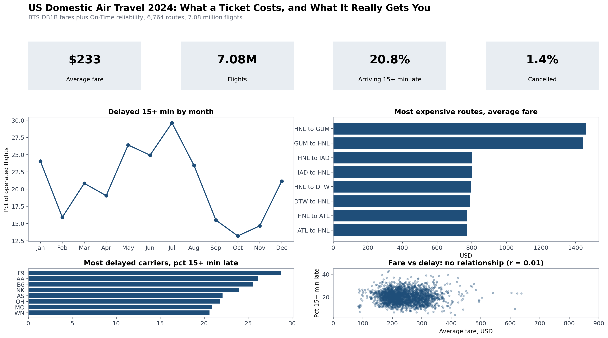
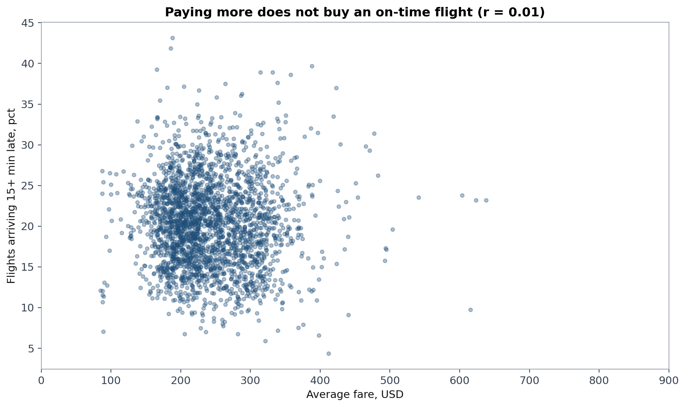
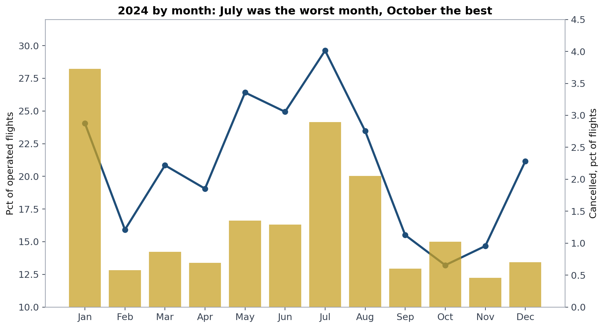
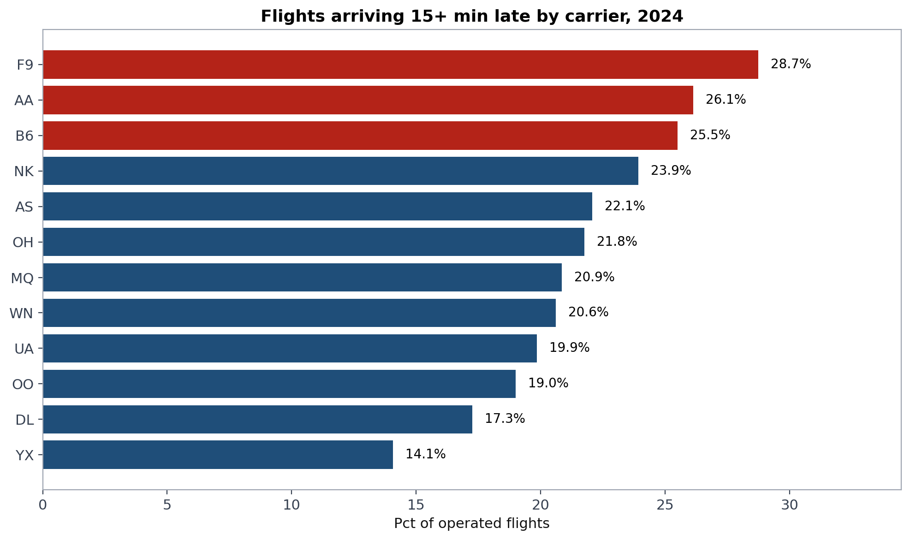
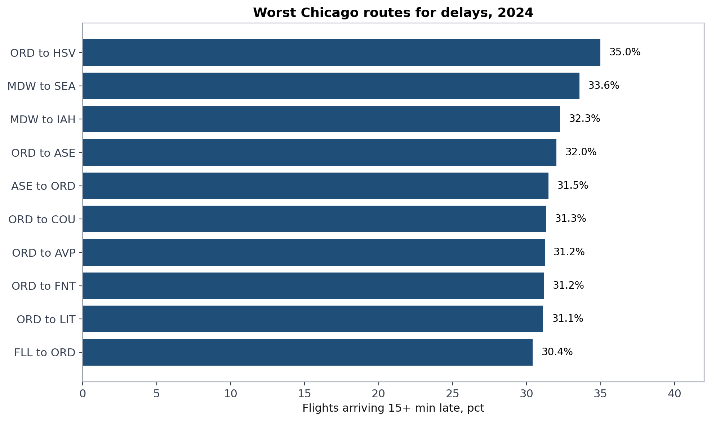

# What a ticket costs, and what it really gets you

I built this because I kept wondering about something simple. When you pay more for a plane ticket, do you actually get a better trip? Not a nicer seat or a better time. A flight that leaves and lands when it says it will.

I pulled two public data sets from the Bureau of Transportation Statistics for 2024 and joined them together. One says what passengers paid. The other says whether their flights ran on time. Put together, they cover 7,079,061 flights and 30,648,135 ticket records, across 6,764 routes.

The short answer is no. Paying more does not buy you an on-time flight. I will get to the numbers below, but that is the whole project in one sentence.

## What I found

First, the headline. Across routes with enough traffic to measure properly, the link between average fare and how often flights arrive late is basically zero. The correlation is 0.01, which in plain words means there is no link at all. Expensive routes run late just as often as cheap ones.

You can see it in this chart. Each dot is a route. Fares run along the bottom, delay rates up the side. If paying more bought reliability, the dots would slope downward as fares rose. They form a flat cloud instead.

The average fare across all domestic routes was $233.35, weighted by passengers, so big routes count more than small ones. One in five flights arrived 15 or more minutes late (20.82 percent), 1.36 percent were cancelled, and the average arrival delay was 7.10 minutes. Those national averages hide a lot, though, so here is where it gets interesting.

Distance explains some of the fare, but only some. The link between distance and fare is 0.53, a real link but a partial one. Routes under 500 miles averaged $185.07. Routes of 2,000 miles or more averaged $347.64. So a route four times as long costs less than twice as much, on average. And delay rates barely move with distance at all, from 19.64 percent on the shortest routes to 20.44 percent on the longest. Longer flights are not less reliable. They are just longer.

July 2024 was the worst month of the year, and it was not close. 29.62 percent of flights arrived late and 2.89 percent were cancelled, out of 634,613 flights. Nearly one in three flights late. October was the calmest for delays at 13.20 percent late. November had the fewest cancellations at 0.46 percent. January is the odd one: the highest cancellation rate of the year at 3.73 percent, but only a middling delay rate. That fits winter weather, where flights get cancelled outright instead of departing hours late. July fits summer strain, where flights still go, just late, in huge numbers.

Carriers split into two groups on price. The ultra low cost carriers charge around $100 to $115 on average: Allegiant at $102.00, Spirit at $113.40, Frontier at $113.41. The big legacy carriers charge around $285 to $305: American at $286.61, United at $300.28, Delta at $305.33. Southwest sits in between at $211.44.

Reliability does not split as cleanly, but the cheap end does worse. Frontier ran late 28.74 percent of the time and cancelled 2.32 percent of its flights, the worst on both counts among the large carriers. At the other end, Delta was the most reliable of the big four at 17.26 percent late and 0.91 percent cancelled, across 1,009,174 flights. Southwest cancelled the least of any large carrier at 0.83 percent, across the most flights in the data at 1,419,419. American was the weakest of the big four at 26.13 percent late, with an average arrival delay of 15.31 minutes, far above Delta's 3.66 minutes.

Two honest cautions here. Average delay gets pulled around by extreme days, so one bad stretch can make a carrier look worse on that number than on the delay rate. And carriers fly different route mixes, so a carrier heavy on storm exposed or congested airports will look worse partly for reasons outside its own scheduling. This table says what happened. It does not by itself prove why.

Aspen is in a class of its own for cancellations. Aspen to Houston cancelled 7.72 percent of its flights. Aspen to Los Angeles cancelled 6.84 percent. Aspen to Chicago O'Hare cancelled 6.53 percent. The national rate is 1.36 percent. Aspen shows up on both sides of each pair, so it is not one carrier or one direction. The data I used does not say why, and I did not want to guess. The cancellation reason codes are the obvious next cut.

Dallas Fort Worth shows up again and again on the delay list. The most delayed route in the country is Key West to Dallas Fort Worth, at 45.75 percent of flights arriving late. Dallas Fort Worth appears in six more of the fifteen most delayed routes. San Francisco arrivals show up a lot too. That pattern points at hub congestion more than any single route's bad luck, though proving that would need airport level data I did not use.

Chicago is where I live, so I cut the tables for O'Hare and Midway separately. The priciest Chicago routes are Hawaii flying: Honolulu to O'Hare at $660.00, Maui to O'Hare at $657.43. At least on those routes the high fare comes with a flight that usually arrives on time, with delay rates from 6.45 to 12.96 percent. Chicago's worst delay routes are short and mid length flying: O'Hare to Huntsville ran late 34.99 percent of the time, Midway to Seattle 33.56 percent. And Aspen to O'Hare cancelled 6.53 percent of the time, the worst cancellation rate of any Chicago route with real volume.

One last thing that surprised me. The busiest routes are not the priciest routes. The busiest by passengers was Los Angeles to New York JFK, with 113,281 sampled passengers at an average fare of $493.59. The busiest by flights was the short hop between Maui and Honolulu, 11,642 flights in the year, about 32 a day, at $87.83. And the cheapest routes in the data are small leisure markets, like Columbus Rickenbacker to Myrtle Beach at $73.41. Cheap does not mean unreliable by default. Portland to Provo at $76.76 ran late only 13.89 percent of the time.

So the practical takeaway, for what it is worth: judge a route on fare and reliability together, never on fare alone. And if you are booking Aspen or connecting through Dallas Fort Worth, build in slack. The data says trouble there is normal, not rare.

## How I built it

The fare data is the BTS Airline Origin and Destination Survey, called DB1B. It is a 10 percent sample of tickets, so passenger counts here are sampled passengers, not total passengers. A route with 113,281 sampled passengers carried roughly ten times that many real passengers. Fares are not scaled up, and they do not need to be: the average fare on a route is the same in the sample as in the full market, as long as the sample is random, which BTS designs it to be.

The reliability data is BTS Airline On-Time Performance, one record per flight. It only covers reporting carriers, which means US carriers with at least 1 percent of domestic scheduled passenger revenue. Big carriers are all in. Some small carriers appear in the fare data but have no reliability data, because they fall below that line. Where that happens I left the reliability blank instead of filling it with a guess.

A few cleaning choices, since they shape the numbers. I kept domestic markets only, which in BTS terms includes US territories, so Guam shows up in the most expensive routes. I dropped fares under $50 before averaging, following BTS guidance, since those records are mostly taxes and fees with no base fare attached. I dropped records with zero or missing passengers. A route means one direction only: O'Hare to LaGuardia is one route, and LaGuardia to O'Hare is a different one, because fares and delays often differ by direction. Delay averages skip cancelled and diverted flights, since a flight that never arrived has no arrival delay to average.

The build itself was not smooth, which is probably worth saying. The first run of the aggregation script ran out of memory because it tried to hold whole quarters of ticket data at once. I rewrote it to read each file in chunks of 300,000 rows and add up partial totals as it went. The second run failed on a column bug. The third run finished clean. Both fixes are in the script, and the scripts are in this repo, so the whole thing can be rerun.

To reproduce it: download the raw files from BTS TranStats into data/raw (the DB1B Market files for all four quarters of 2024, and the On-Time files for all twelve months), run build_routes.py, then run make_charts.py. The numbers here come from data/findings.txt and the tables in data. I used Python and pandas for the cleaning and aggregation, and matplotlib for the charts.

## What this can't tell you

DB1B is a sample, not a census of every ticket sold, so fares are the best available estimate, not an exact count. Dropping fares under $50 could slightly overstate averages on the cheapest routes, if some of those records were real low fares. Small carriers have no reliability numbers here, and blank means missing, not zero delays. I did not use the fare class field, because the Department of Transportation warns that carriers code it differently, so it does not mean the same thing across carriers. Distance in DB1B is market distance, which can include ground transport legs, so it is close to flight distance on most routes but not identical. And this is 2024 only. Fares, schedules, and networks change every year, so none of this is a forecast.

If I keep going with this, the next steps in order are: add T100 seat capacity so I can look at load factor, break cancellations down by reason code and month, and rebuild the charts as a Tableau dashboard with airport filters so a reader can look up their own routes.

Built by Matthew Karan. GitHub: github.com/matthewkaran33.
